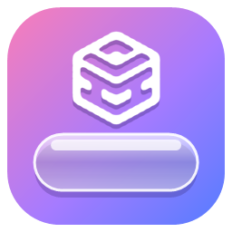

<p align="center"></p>

<h1 align="center">Liquid Dock</h1>

<p align="center">Windows 작업표시줄 대신 쓰는 macOS 스타일 <b>리퀴드 글라스 독</b></p>

---

## 특징

- **진짜 리퀴드 글라스** – 독 뒤 화면을 실시간으로 받아 GPU 셰이더로 굴절·색수차·흐림·하이라이트를 입힙니다. 배경이 밝으면 글자색도 자동으로 바뀝니다.
- **마우스를 올릴 때만 등장** – 화면 가장자리에 마우스를 대면 스프링 애니메이션으로 나타나고, 벗어나면 숨습니다.
- **맥 같은 확대 효과** – 아이콘 위에서 물결처럼 커집니다.
- **알림은 통통 튀게** – 카톡 등 앱이 알림을 보내면 독은 숨긴 채 해당 아이콘만 화면 끝에서 고개를 내밀고 튑니다(메인 모니터).
- **상하좌우 어디든** – 모니터마다 독이 하나씩 뜹니다. 크기는 Windows 배율이 아니라 화면 크기에 맞춰져서, 해상도가 다른 모니터에서도 화면에서 차지하는 비율이 같습니다.
- **시스템 모니터** – 독 맨 끝 칸에 CPU/GPU 상태, 마우스를 올리면 CPU·GPU·RAM·SSD 사용량과 온도, 1분 그래프. 과열 시 한 번만 튀어서 알려 줍니다.
- **Windows 진짜 트레이 연동** – 직접 흉내 낸 게 아니라 Windows 자체 창을 그대로 엽니다.
  - `›` 버튼: 숨겨진 아이콘(알림 영역 오버플로) 창. 디스코드·스팀·블루투스 같은 아이콘이 각자의 원래 메뉴와 함께 나옵니다.
  - 시계: Windows 달력 창 / Wi-Fi: 빠른 설정 / 볼륨: Windows 볼륨 슬라이더
  - 일반 Windows 11과, 윈도우 10 스타일 작업표시줄(ExplorerPatcher)에서 확인했습니다.
  - 일반 Windows 11에서는 Windows가 숨겨진 아이콘 창의 위치를 옮기지 못하게 해서, 원래 있던 오른쪽 아래에 열립니다.
- **우클릭 메뉴** – 볼륨·네트워크·시계·시스템 모니터 칸을 우클릭하면 각각 Windows 작업표시줄과 비슷한 메뉴(소리 설정, 네트워크 설정, 날짜 및 시간 조정, 작업 관리자 등)가 뜹니다.
- **원클릭 버튼** – 설정 창에서 원하는 버튼을 독으로 끌어다 놓아 추가·정렬합니다(작은 버튼은 두 개씩 한 칸에 들어갑니다).
  - 바탕화면 보기, 다크/라이트 전환, OLED 모드(검은 배경·아이콘 숨김, 번인 방지), 화면 꺼짐 방지, 스크린샷,
    알림 튐 끄기, 휴지통(파일을 끌어다 놓기), 최근 다운로드, 오디오 장치 전환, SFF 갤러리 바로가기
- **Shift+클릭** 으로 앱을 관리자 권한으로 실행합니다.
- **기존 작업표시줄 앱 자동 가져오기** – 작업표시줄에 고정해 둔 앱을 순서 그대로 가져옵니다. 스토어(MSIX) 앱(Claude, ChatGPT 등)도 포함입니다. 이후 드래그로 순서 변경·고정/해제가 됩니다.

## 설정

독 끝의 톱니 버튼(또는 빈 곳 우클릭 → 설정)으로 설정 창이 열립니다. 바꾸는 즉시 독에 반영됩니다.

- 위치: 아래 / 왼쪽 / 오른쪽 / 위 (어느 가장자리든)
- 모양: 독 두께, 화면 가장자리와의 거리, 가장자리를 따라 옮기기(슬라이더)
- 아이콘 크기·간격, 확대 효과, 유리 질감, 나타나는 속도
- 자동 숨김 켜기/끄기, 독을 불러오는 단축키
- 버튼: 끌어다 놓아 추가·제거·순서 변경
- Windows 시작 시 자동 실행
- CPU 온도 표시 (선택, 아래 참고)

## 설치

1. [Releases](../../releases)에서 `LiquidDock-Setup.exe`를 받아 실행합니다.
2. **"Windows의 PC 보호"** 창이 뜨면 → **추가 정보** → **실행**. (코드 서명 인증서가 없는 개인 프로젝트라서 뜨는 경고입니다. 소스는 모두 이 저장소에 있습니다.)
3. 실행하면 바로 설치되고 독이 잠깐 나타납니다. 관리자 권한이 필요 없고 내 계정에만 설치됩니다(`%LOCALAPPDATA%\Programs\LiquidDock`).

- **자동 실행**은 로그온 직후에 바로 시작됩니다(사용자 단위 로그온 작업 + 시작 프로그램 레지스트리 보조, 관리자 권한 불필요).
- 제거: **설정 → 앱 → 설치된 앱 → Liquid Dock → 제거**

### 기본 작업표시줄은 어떻게 되나요?

독이 실행되는 동안 Windows 기본 작업표시줄은 보이지 않게 됩니다(자동 숨김 + 화면에 그리지 않음). 독을 끄거나 제거하면 원래대로 돌아옵니다.

- 독을 종료하면(독 우클릭 → 종료) 작업표시줄이 복원됩니다.
- 문제가 생기면 **Ctrl+Alt+Shift+F12** 로 즉시 종료됩니다.
- 시작 메뉴의 **"Liquid Dock - 작업표시줄 복원"** 을 실행해도 독을 끄고 기본 작업표시줄을 되돌립니다.

## CPU 온도 (선택 기능)

Windows는 CPU 온도를 일반 프로그램에 주지 않기 때문에, CPU 온도만은 드라이버가 필요합니다.

1. [PawnIO](https://pawnio.eu/) 드라이버 설치 (LibreHardwareMonitor·FanControl 등이 쓰는 서명된 오픈소스 드라이버)
2. 독 맨 끝 칸 클릭 → 관리자 확인 1회

그 뒤로는 확인 창 없이 자동으로 켜집니다. 지원: AMD Ryzen, Intel. GPU 온도는 NVIDIA만 지원합니다.
이 기능을 켜지 않아도 사용량 표시를 포함한 나머지 기능은 모두 동작합니다.

일부 게임의 안티치트는 커널 드라이버를 싫어할 수 있습니다. PawnIO는 선택 사항이니, 그런 게임을 하신다면 설치하지 않거나 CPU 온도 표시를 끄세요.

## 요구 사항

- Windows 11 권장. Windows 10(2004 이상)은 실험적 지원이며, 개발자가 직접 검증하지 못했습니다.
- DirectX 11 그래픽

## 알려진 한계

- 창 미리보기 썸네일은 없고, 우클릭 메뉴의 창 목록을 씁니다.
- 일반 Windows 11에서 숨겨진 아이콘 창은 Windows가 정한 위치(오른쪽 아래)에 열립니다.
- Windows 10, Intel CPU 온도는 개발자 PC에서 직접 검증하지 못했습니다. 문제가 있으면 Issues에 남겨 주세요.

## 개인정보

Liquid Dock은 **인터넷에 아무것도 보내지 않습니다.** 독 뒤 화면 캡처는 GPU 안에서 유리 효과를 그리는 데만 쓰이고 저장되지 않습니다. 설정은 설치 폴더의 `data` 폴더에만 저장됩니다.

## 직접 빌드

Visual Studio 2022 Build Tools(C++ 데스크톱, Windows SDK) 설치 후:

```bat
build.bat
```

`build\LiquidDock-Setup.exe`가 만들어집니다. `build.bat dev`로 빌드하면 실행 중인 독을 조작하는 개발자용 명령(`--debug-*`, `--snap` 등)이 추가됩니다. 구조:

| 폴더 | 내용 |
|---|---|
| `src/` | 독 본체 (Win32, Direct3D 11, DirectComposition, Windows.Graphics.Capture) |
| `sensors/` | CPU 온도용 선택적 관리자 도우미 |
| `installer/` | 설치/제거 프로그램 |

## 라이선스

MIT. 포함된 PawnIO 모듈은 LGPL-2.1 — [THIRD_PARTY_NOTICES.txt](THIRD_PARTY_NOTICES.txt) 참고.
